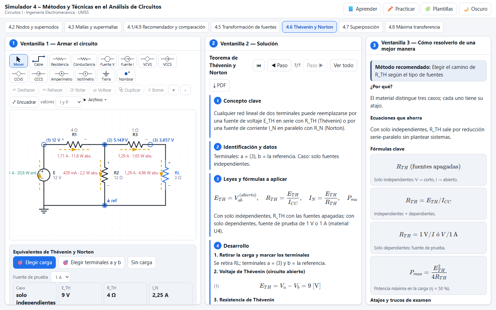
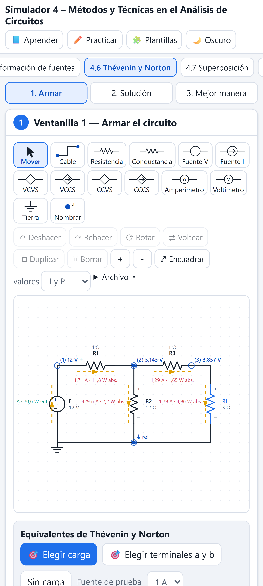

# Simulador 4 – Métodos y Técnicas en el Análisis de Circuitos

Simulador web de la **Unidad 4 de Circuitos I** (UMSS, Ingeniería Electromecánica). Incluye nodos y supernodos (con matriz de conductancias), mallas y supermallas (con matriz de resistencias y aviso de circuito no planar), fuentes dependientes, transformación de fuentes, un recomendador de método que compara nodos y mallas, Thévenin y Norton (con los tres casos del material: fuentes apagadas, E_TH/I_CC y fuente de prueba de 1 V o 1 A), superposición y máxima transferencia de potencia. El sistema se puede resolver por sustitución, Cramer o Gauss.

**Página publicada:** https://angelja19.github.io/simulador-4-metodos-de-analisis/

| Escritorio | Celular |
| --- | --- |
|  |  |

## Casos verificados por las pruebas
- Mallas con 4V_Δ (V_Δ = 30·I₄): I₁ = 3,75; I₂ = 2,5; I₃ = 1,25; I₄ = 0,5 A. La fuente entrega 375 W y la dependiente absorbe 75 W (375 = 300 + 75). La geometría se dedujo de los resultados.
- Cuaderno, problema 4: 5,6; 2 y −0,8 A. Problema 10 (supermalla): 1,25; 1,75 y 6,75 A. Problema 14 (nodos): V₁ = 9,09 V y V₂ = 10,909 V.
- TP4 de nodos, ejercicio 1: Iₐ = 0,84 A, V₁₅ = 12,54 V y P₁₅ ≈ 10,48 W.

## Uso
```bash
npm install
npm run dev
npm test
npm run test:e2e
```

Licencia [MIT](LICENSE).
